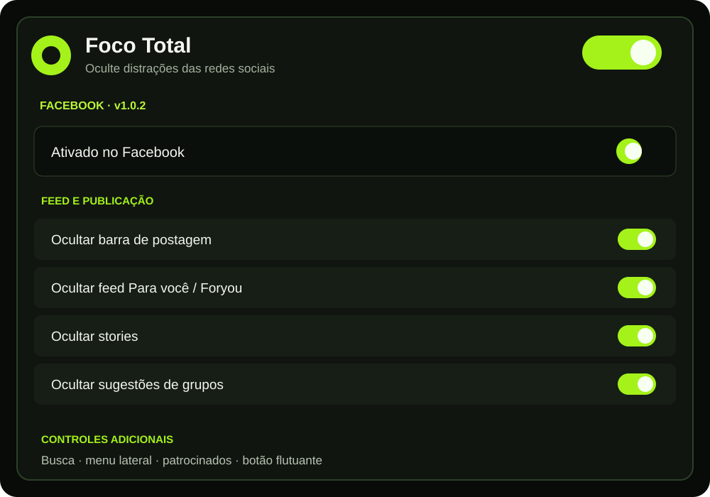
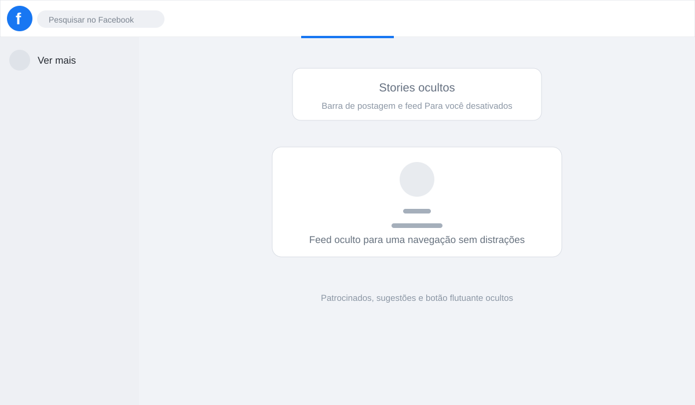

# Foco Total

Extensão para Chrome e Brave (Manifest V3) que remove distrações das redes
sociais de forma seletiva. Cada item pode ser ligado ou desligado no painel,
sem conta, sem backend, sem telemetria e sem chamadas de rede.

**Versão atual: 1.0.6** · [Baixar o pacote ZIP](foco-total-v1.0.6.zip)

## Veja a extensão

As imagens abaixo são prévias públicas da interface, sem dados de uma conta
real:





## O que ela controla

- **Facebook:** barra de postagem, feed Para você/Foryou, rolagem do feed,
  stories, sugestões de grupos, placeholders de carregamento, patrocinados,
  ações da conta, ícones da navegação superior, menu lateral individual ou
  inteiro, busca, rodapé, botão flutuante e controles adicionais dentro dos
  perfis (sugestões, Amigos, Fotos, abas e controles individuais do cabeçalho).
- **X, Instagram, TikTok e YouTube:** controles específicos de feed,
  navegação, recomendações, vídeos, anúncios e elementos de interface.
- **Privacidade:** todas as configurações ficam em `chrome.storage.local`.

O popup oferece restauração por rede social no painel selecionado e restauração
global ao lado da engrenagem. O reset individual preserva as demais redes.

## Instalação

1. Baixe [foco-total-v1.0.6.zip](foco-total-v1.0.6.zip) e extraia a pasta.
2. Abra `chrome://extensions` (ou `brave://extensions`).
3. Ative o **Modo do desenvolvedor**.
4. Clique em **Carregar sem compactação** e selecione a pasta extraída.
5. Abra o popup da extensão e escolha a plataforma e os controles.

Após atualizar os arquivos de uma instalação local, clique em **Recarregar**
na página de extensões e atualize a aba da rede social.

## Documentação

- [Instalação](docs/INSTALACAO.md)
- [Permissões](docs/PERMISSOES.md)
- [Mapeamento técnico dos seletores](docs/MAPEAMENTO_ELEMENTOS.md)
- [Limitações conhecidas](docs/LIMITACOES.md)
- [Checklist de testes](docs/CHECKLIST_TESTES.md)
- [Contexto e histórico de decisões](CONTEXTO.md)

## Estrutura

```
manifest.json      MV3, permissao storage
popup/             painel (HTML/CSS/JS puros, dark + verde-neon)
content/engine.js  motor: CSS injetado reversível + MutationObserver único
content/x.js       regras do X
content/instagram.js  regras do Instagram
content/tiktok.js  regras do TikTok (inventário via inspeção ao vivo)
content/youtube.js regras do YouTube (organização inspirada na Unhook)
content/facebook.js regras do Facebook (roles/aria e rotas confirmados ao vivo)
icons/             ícones originais
docs/              documentação técnica
```

## Facebook na versão 1.0.6

A implementação do Facebook foi validada em uma sessão autenticada do Chrome.
Ela usa landmarks acessíveis e rotas observadas ao vivo, com guardas
dimensionais nas heurísticas dinâmicas. O motor reconhece tanto `main` quanto
`[role="main"]`, porque a home atual do Facebook renderiza o conteúdo como um
`div` com `role="main"`.

## Estado técnico da versão 1.0.6

O motor não possui background service worker, é idempotente, usa um único
observer quando necessário e processa mutações por raízes adicionadas. CSS e
regras dinâmicas do Facebook respeitam a rota, e um content script órfão após
reload da extensão limpa suas marcas com segurança. O catálogo e os detalhes
de compatibilidade ficam em [CONTEXTO.md](CONTEXTO.md) e
[docs/MAPEAMENTO_ELEMENTOS.md](docs/MAPEAMENTO_ELEMENTOS.md).

